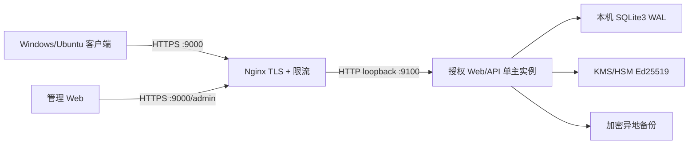

# 104.224.90.172 云端授权服务部署设计

> 状态：部署规格；授权 Web/API 尚未实现和部署  
> 公网入口：`https://104.224.90.172:9000`
> 已确定：Enterprise Linux 9 系列、人工部署、Let's Encrypt IP 短期证书

逐条部署命令、Nginx 配置、SELinux、防火墙及续期方案见
[`MANUAL_DEPLOY_EL9_IP_CERT.md`](MANUAL_DEPLOY_EL9_IP_CERT.md)。

## 1. 拓扑



公网 9000 只由反向代理监听。授权应用只绑定 `127.0.0.1:9100`；SQLite3 文件位于本机持久磁盘，
不能由客户端、管理浏览器、反向代理或其他服务器直接访问。

## 2. TLS 方案

任何用户名、激活码、访问令牌或设备令牌都不得通过明文 HTTP 传输。

已经确认使用受信任的 IP 地址短期证书，入口为 `https://104.224.90.172:9000`。证书自动续期并在
剩余 48 小时时报警；正式客户端禁止关闭证书验证、接受自签名证书或自动降级到 HTTP。所选
HTTP-01 方案还需要开放 `80/tcp`，仅用于 `/.well-known/acme-challenge/`，其他路径返回 404。

客户端不要把激活码、访问令牌放在 URL query string；它们只能位于 HTTPS 请求体或 Authorization
header。反向代理访问日志必须过滤 Authorization、Cookie、激活码和完整设备摘要。

## 3. 网络与进程

防火墙基线：

| 端口 | 来源 | 作用 |
|---|---|---|
| TCP 9000 | 公网 | HTTPS Web/API |
| TCP 80 | 公网 | ACME HTTP-01 首次签发与续期 |
| TCP 22 | 管理员固定 IP/VPN | SSH 运维 |
| TCP 9100 | 仅 loopback | 内部授权应用 |
| SQLite 文件 | 非网络端口 | 仅授权服务系统用户读写 |

不开放 SQLite、调试器、开发服务器和 KMS 管理接口。服务以专用非 root 系统用户运行；代码目录只读，
数据库、WAL、备份暂存和审计日志分别设置最小权限。

建议目录：

```text
/opt/wechat-memory-license/                 # 只读发布版本
/etc/wechat-memory-license/service.env      # 0600，非仓库文件
/var/lib/wechat-memory-license/
├─ license.sqlite3                          # 0600
├─ license.sqlite3-wal
├─ license.sqlite3-shm
└─ backups/
/var/log/wechat-memory-license/             # 不记录秘密
```

## 4. 客户端权限流程

### 4.1 首次激活

```text
客户端 → POST /v1/activate
         username + activation_code + install_id + device_hash
服务端 → 验证用户、激活码摘要、套餐状态、设备配额
服务端 → 绑定设备并返回短期 access token、轮换 refresh token、签名 license ticket
客户端 → 用内置 Ed25519 公钥验证 license ticket，随后存入 DPAPI/系统密钥环
```

仅“用户名存在”不能证明调用者身份，因此首次激活必须同时提交注册脚本生成的高熵激活码。数据库只
保存激活码摘要；激活成功后改用可吊销、可轮换的设备 refresh token。

### 4.2 打开界面时刷新

客户端每次打开界面时：

1. 先验证本地缓存授权票据的签名、产品、设备、时间和功能位；
2. 在后台调用 `POST /v1/licenses/refresh` 获取当前权限；
3. 服务端返回新的签名票据和下次刷新时间；
4. 权限变化通过本地 capability gate 生效；
5. 客户端关闭后不做后台心跳，与聊天实时同步的生命周期一致。

建议响应内容：

```json
{
  "server_time": "2026-10-17T12:00:00Z",
  "entitlement_status": "active",
  "plan": "pro_subscription",
  "features": ["realtime_sync", "multi_account", "batch_export"],
  "device_id": "dev_...",
  "device_limit": 3,
  "refresh_after": "2026-10-17T18:00:00Z",
  "offline_until": "2026-11-16T12:00:00Z",
  "license_ticket": "base64url(payload).base64url(signature)",
  "key_id": "2026-01"
}
```

`license_ticket` 必须覆盖 payload 全部字段并使用 Ed25519 签名。客户端不能只相信普通 JSON 中的
`features`，必须验证签名票据、`audience`、`issuer`、`device_id`、`not_before`、`expires_at` 和
`key_id`。

### 4.3 服务不可用或授权到期

- 网络失败但票据仍在 `offline_until` 内：按票据功能继续工作；
- 超出离线期限或权益到期：进入只读模式；
- 只读模式允许查看、搜索本地已有个人档案；
- 停止新同步、统计计算和新建导出；
- 不删除数据库、媒体或已经生成的导出物；
- 服务恢复或续期后刷新票据，无需重新导入聊天档案。

## 5. 首版 API

```text
GET  /healthz                         # 不泄露数据库路径或版本细节
GET  /readyz                          # 仅供本机/监控访问
POST /v1/activate
POST /v1/licenses/refresh
GET  /v1/licenses/status
POST /v1/devices/deactivate
POST /v1/devices/unbind-request
GET  /v1/time
GET  /v1/keys                         # 只返回公钥与轮换元数据
GET  /admin                           # 管理 Web，必须独立管理员认证和 MFA
```

所有状态改变请求使用 `request_id` 幂等键、服务端时间窗口和 nonce，限制请求体大小并实施按 IP、用户、
激活码前缀和设备的组合限流。连续失败不会透露“用户名存在但激活码错误”还是“用户不存在”。

## 6. SQLite3 运行要求

- 单主授权 API 实例；
- 数据库在本机持久磁盘，不放 NFS/SMB；
- WAL、外键、`synchronous=FULL`、5 秒 busy timeout；
- 写操作 `BEGIN IMMEDIATE`、短事务、重试有上限；
- 每日使用 Online Backup API 生成一致性备份；
- 备份加密后复制到异地，定期执行实际恢复与 `integrity_check`；
- 监控磁盘空间、WAL 大小、checkpoint、写锁等待、API P95 和错误率；
- 达到多主或高并发写需求时迁移数据库，不共享 SQLite 文件。

## 7. 上线前仍需提供

- EL9 的具体发行版与小版本；
- SSH 管理来源 IP/VPN；
- KMS/HSM 提供商；
- 备份目标与保留周期；
- 管理员初始账号和 MFA 方式；
- 最终隐私政策、EULA 和数据保留期限。

基础设施手册可先执行到证书和反向代理验证；授权 API、签名密钥和剩余安全信息齐备前不能正式
对公网提供激活服务。
