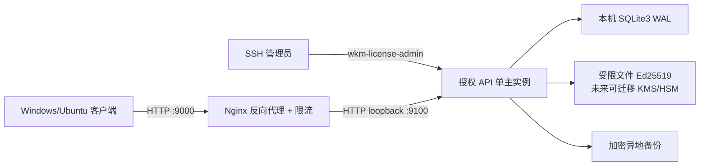

# 104.244.90.172 云端授权服务部署设计

> 状态：授权 Web/API 已实现；等待在目标服务器手工部署
> 公网入口：`http://104.244.90.172:9000`
> 已确定：Enterprise Linux 9 系列、人工部署、默认 HTTP 9000；TLS 作为未来显式选项
> 当前生产命令以 [`SERVER_OPERATIONS_RUNBOOK.md`](SERVER_OPERATIONS_RUNBOOK.md) 为准。

默认部署命令、Nginx 配置、SELinux 和防火墙见
[`ONE_CLICK_DEPLOY_AND_ADMIN.md`](ONE_CLICK_DEPLOY_AND_ADMIN.md)。可选 IP 证书方案见
[`MANUAL_DEPLOY_EL9_IP_CERT.md`](MANUAL_DEPLOY_EL9_IP_CERT.md)。

此文档与发行模板已从早期误写的 `104.224.90.172` 迁移到服务器实际绑定的
`104.244.90.172`。旧地址只作为迁移历史和错误输入回归样本，不得出现在
Nginx、systemd、默认参数或验收 URL 中。已有的 WeChatMemory 旧 IP bootstrap 文件会先进入
部署事务快照，再重建为当前 IP；任一后续步骤失败都按字节恢复旧文件与 Nginx 运行态。

## 1. 拓扑



公网 9000 只由反向代理监听。授权应用只绑定 `127.0.0.1:9100`；SQLite3 文件位于本机持久磁盘，
不能由客户端、管理浏览器、反向代理或其他服务器直接访问。

## 2. 传输方案与已接受风险

当前产品决策接受 `http://104.244.90.172:9000`。WebSocket 本身不会加密，因此不能改善 HTTP 的
链路保密性，也不适合替代短请求授权 API。用户名、一次性激活码和 refresh token 均可能被同链路
观察者读取；Ed25519 只防票据伪造，设备绑定、token 轮换和限流只能缩小损失，不能提供保密性。

为降低风险，激活码在首次成功激活的同一 SQLite 写事务内原子置为 `revoked`，并记录消费审计；
并发或后续重放统一返回 401。refresh token 默认 365 天、每次成功刷新立即轮换并绑定
`install_id + device_hash`。较长生命周是为了覆盖永久个人版 180 天离线承诺，但在明文 HTTP 下也扩大了
窃听后的风险窗口。客户端不得把任何秘密放在 URL query string，Nginx 访问日志不得记录
Authorization、Cookie、请求体或完整设备摘要。云安全组应尽量限制 9000 的访问来源。

未来需要链路保密时，必须先发布内置匹配 HTTPS origin/信任策略的新客户端，再显式选择
`--tls-mode letsencrypt|existing --ack-client-https-origin-ready`。当前 Client `0.3.5` 只允许固定 HTTP，
不兼容 TLS 入口。默认 HTTP 部署不开放 80、不创建 ACME webroot、不安装或运行 Certbot，也不依赖证书成功与否。

## 3. 网络与进程

防火墙基线：

| 端口 | 来源 | 作用 |
|---|---|---|
| TCP 9000 | 公网（建议限制来源） | HTTP Web/API |
| TCP 80 | 默认关闭 | 仅显式 letsencrypt 模式的 ACME HTTP-01 |
| TCP 22 | 管理员固定 IP/VPN | SSH 运维 |
| TCP 9100 | 仅 loopback | 内部授权应用 |
| SQLite 文件 | 非网络端口 | 仅授权服务系统用户读写 |

不开放 SQLite、调试器、开发服务器和 KMS 管理接口。服务以专用非 root 系统用户运行；代码目录只读，
数据库、WAL、备份暂存和审计日志分别设置最小权限。

建议目录：

```text
/opt/wechat-memory-license/                 # 只读发布版本
/etc/wechat-memory-license/service.env      # 0600，非仓库文件
/var/lib/wechat-memory-license/
├─ license.sqlite3                          # 0600
├─ license.sqlite3-wal
├─ license.sqlite3-shm
└─ backups/
/var/log/wechat-memory-license/             # 不记录秘密
```

## 4. 客户端权限流程

### 4.1 首次激活

```text
客户端 → POST /v1/activate
         username + activation_code + install_id + device_hash
服务端 → 验证用户、激活码摘要、套餐状态、设备配额
服务端 → 原子消费激活码、绑定设备并返回轮换 refresh token 和签名 license ticket
客户端 → 用内置 Ed25519 公钥验证 license ticket，随后存入 DPAPI/系统密钥环
```

仅“用户名存在”不能证明调用者身份，因此首次激活必须同时提交注册脚本生成的高熵激活码。数据库只
保存激活码摘要；激活成功后该凭据立即失效，后续需要重新激活必须由管理员 reset 生成新码，然后
改用可吊销、可轮换的设备 refresh token。

### 4.2 打开界面时刷新

客户端每次打开界面时：

1. 先验证本地缓存授权票据的签名、产品、设备、时间和功能位；
2. 在后台调用 `POST /v1/licenses/refresh` 获取当前权限；
3. 服务端返回新的签名票据和下次刷新时间；
4. 权限变化通过本地 capability gate 生效；
5. 客户端关闭后不做后台心跳，与聊天实时同步的生命周期一致。

当前响应为结构化 JSON，核心字段如下：

```json
{
  "server_time": "2026-10-17T12:00:00Z",
  "refresh_after": "2026-10-17T18:00:00Z",
  "refresh_token": "wkmr_...",
  "ticket": {
    "device_id": "4cf3...",
    "install_id": "客户端随机安装标识",
    "device_hash": "64位小写十六进制匿名设备摘要",
    "plan": "pro_subscription",
    "capabilities": ["realtime_sync", "multi_account", "batch_export"],
    "offline_until": "2026-11-16T12:00:00Z",
    "key_id": "2026-10-30",
    "signature": "base64url-ed25519-signature"
  }
}
```

`ticket.signature` 覆盖 ticket 全部其他字段。客户端必须验证签名票据、`audience`、`issuer`、
`install_id`、`device_hash`、`not_before`、`expires_at` 和 `key_id`。服务端的 `device_hash` claim
来自已验证的 `devices` 行；refresh/status 继续使用 refresh session 联接到的同一设备绑定，不采用任意请求值。

### 4.3 服务不可用或授权到期

- 网络失败但票据仍在 `offline_until` 内：按票据功能继续工作；
- 超出离线期限或权益到期：进入只读模式；
- 只读模式允许查看、搜索本地已有个人档案；
- 停止新同步、统计计算和新建导出；
- 不删除数据库、媒体或已经生成的导出物；
- 服务恢复或续期后刷新票据，无需重新导入聊天档案。

## 5. 首版 API

```text
GET  /healthz                         # 不泄露数据库路径或版本细节
GET  /readyz                          # 可公网监控的版本化最低 schema/可用性检查，受限流
GET  /readyz/deep                     # 只允许 loopback 的 SQLite quick_check，Nginx 返回 404
POST /v1/activate
POST /v1/licenses/refresh
GET  /v1/licenses/status
POST /v1/devices/deactivate
GET  /v1/time                         # 受应用限流
GET  /v1/keys                         # 只返回公钥与轮换元数据，受应用限流
```

当前实现限制 16 KiB 请求体；除廉价 `/healthz` 与仅本机 `/readyz/deep` 外，公网 API 均实施
按 IP 和进程全局滑动窗口限流。refresh token 每次成功使用都原子轮换。
连续失败不会透露“用户名存在但激活码错误”还是“用户不存在”。后续多实例部署时需将内存限流迁移到共享后端。

## 6. SQLite3 运行要求

- 单主授权 API 实例；
- 数据库在本机持久磁盘，不放 NFS/SMB；
- WAL、外键、`synchronous=FULL`、5 秒 busy timeout；
- 写操作 `BEGIN IMMEDIATE`、短事务、重试有上限；
- 每日使用 Online Backup API 生成一致性备份；
- 备份加密后复制到异地，定期执行实际恢复与 `integrity_check`；
- 监控磁盘空间、WAL 大小、checkpoint、写锁等待、API P95 和错误率；
- 达到多主或高并发写需求时迁移数据库，不共享 SQLite 文件。

## 7. 上线前仍需确认

- EL9 的具体发行版与小版本；
- SSH 管理来源 IP/VPN；
- 签名私钥何时从受限文件迁移到 KMS/HSM；
- 备份目标与保留周期；
- 管理员初始账号和 MFA 方式；
- 最终隐私政策、EULA 和数据保留期限。

授权 API 已完成，但在签名私钥、HTTP 公网入口、备份和监控全部验收前不能标记为正式生产服务。
