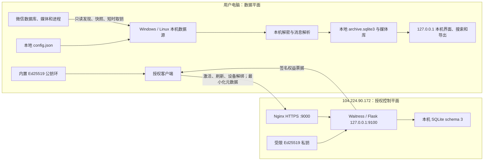

# 跨仓库交付总览与文档治理规范

> 基线日期：2026-10-30
> 客户端：`WeChatMemory-Client 0.3.3`
> 授权服务端：`WeChatMemory-LicenseServer 0.2.3`
> 授权协议：`v1`；服务端 SQLite schema：`3`；公钥清单 schema：`1`

本文是客户端与授权服务端协同发布的入口。它说明两个仓库的边界、部署顺序、版本与信任根检查，
并规定代码变更后必须同步哪些文档。命令参数若与本文不一致，以当前分支脚本的 `--help` 和源码为准，
但发现不一致时必须在同一变更中修正文档，不能长期保留“双重真相”。

## 1. 仓库和事实来源

| 主题 | 唯一事实来源 | 辅助说明 |
|---|---|---|
| 客户端版本、依赖和入口 | [`WeChatMemory-Client/pyproject.toml`](https://github.com/gladlyknow/WeChatMemory-Client/blob/main/pyproject.toml) | `src/wechat_memory/__init__.py` 必须相同 |
| 本地数据链路与安全边界 | [客户端技术架构](https://github.com/gladlyknow/WeChatMemory-Client/blob/main/docs/TECHNICAL_ARCHITECTURE.md) | 用户操作见[用户手册](https://github.com/gladlyknow/WeChatMemory-Client/blob/main/docs/USER_GUIDE.md) |
| 消息类型和富媒体覆盖 | [消息覆盖矩阵](https://github.com/gladlyknow/WeChatMemory-Client/blob/main/docs/MESSAGE_TYPE_COVERAGE.md) | 必须区分“解析”“归档”“预览”“导出” |
| 客户端授权验证 | [授权协议](https://github.com/gladlyknow/WeChatMemory-Client/blob/main/docs/LICENSE_PROTOCOL.md) | 实现以 `src/wechat_memory/license.py` 为准 |
| 服务端 API、票据和数据模型 | [`LICENSE_SERVER_ARCHITECTURE.md`](LICENSE_SERVER_ARCHITECTURE.md) | 路由以 `license_server/app.py` 为准 |
| SQLite schema | `schema.sql` 和迁移代码 | 文档不能代替迁移测试 |
| 生产部署与管理员命令 | [`ONE_CLICK_DEPLOY_AND_ADMIN.md`](ONE_CLICK_DEPLOY_AND_ADMIN.md) | 参数以脚本 `--help` 为准 |
| 签名密钥生成、备份和轮换 | [`SIGNING_KEY_OPERATIONS.md`](SIGNING_KEY_OPERATIONS.md) | 私钥绝不进入仓库 |
| P0/P1/P2、授权不变量和发布签字 | [`ACCEPTANCE_CRITERIA.md`](ACCEPTANCE_CRITERIA.md) | 未有证据视为未通过 |
| proprietary 许可、第三方来源和精确依赖 | [`LEGAL_AND_SBOM_RELEASE_GATE.md`](LEGAL_AND_SBOM_RELEASE_GATE.md)、根 `LICENSE`、`THIRD_PARTY_NOTICES.md` 和 `sbom/server-runtime.spdx.json` | 自动门禁不等于法律批准；正式商用必须有人类法务/合规签字 |
| 服务端公开信任清单 | `config/signing-public-keys.json` | 客户端只接收经过审核的镜像 |
| 客户端内置信任根 | `security/license-public-keys.json` 和生成的 `license_trust.py` | `/v1/keys` 仅诊断，不能建立信任 |

历史执行记录若与上述资料冲突，只能作为背景阅读。历史文档必须在首屏注明“禁止用于当前部署”，
不能继续包含看似可执行的旧入口、旧端口或旧 API。

## 2. 总体架构与边界



### 2.1 永不上云的数据

- 聊天正文、引用正文、媒体文件和联系人资料；
- 微信账号 `wxid`、数据库密钥、解密后的数据库和本地归档；
- 搜索词、导出内容、完整本机路径和进程内存；
- 任何可用于恢复微信数据的秘密。

### 2.2 授权服务允许接收的数据

- 授权用户名和一次性激活码；服务端仅持久化激活码摘要；
- 安装标识、匿名设备摘要、平台和客户端版本；
- 刷新令牌、设备状态、套餐、能力、到期时间和审计事件。

服务端签名票据中的 `device_id`、`install_id` 和 `device_hash` 必须来自已验证的设备数据库行；
激活请求、刷新请求或状态查询都不得把未经绑定校验的任意 payload 值直接提升为签名 claims。

支付、退款、邮箱或手机号真实性验证不属于当前服务。用户存在性也不等同于身份认证，首次激活必须
同时具备高熵一次性激活码。授权到期后由客户端执行只读降级，不能删除或上传用户的本地档案。

## 3. 端到端首次部署顺序

以下顺序同时适用于首次发布和更换信任根后的完整发布。不得先切换服务端私钥，再等待客户端更新。

### 3.1 在相邻工作目录中同步信任根

先在服务端验证公开清单：

```bash
cd WeChatMemory-LicenseServer
python -m license_server signing-key manifest \
  --manifest config/signing-public-keys.json
python -m unittest discover -s tests -v
```

再把经过审核的服务端公开清单复制到客户端，并重新生成 Python 常量：

```bash
cd ../WeChatMemory-Client
install -m 0644 \
  ../WeChatMemory-LicenseServer/config/signing-public-keys.json \
  security/license-public-keys.json
python scripts/sync_license_public_keys.py
python scripts/sync_license_public_keys.py --check
cmp -s security/license-public-keys.json \
  ../WeChatMemory-LicenseServer/config/signing-public-keys.json
python -m unittest discover -s tests -v
python scripts/release_preflight.py
```

`cmp` 无输出且退出码为 0 才表示两份清单逐字节一致。生成文件
`src/wechat_memory/license_trust.py` 也必须随客户端代码提交。客户端绝不能在运行时把 `/v1/keys`
返回值当作新的信任根；否则攻击者只需控制网络或服务端就能替换签名公钥。

### 3.2 准备生产私钥和服务器源码

生产私钥默认在目标机 `/root/wkm-signing-ed25519.pem`，所有者 `root:root`、权限 `0600`。先按
[`SIGNING_KEY_OPERATIONS.md`](SIGNING_KEY_OPERATIONS.md) 完成离线备份、指纹记录和清单匹配验证。
Git 仓库只能包含公开清单，不能包含 PEM 私钥、恢复介质或激活码。

目标机源码目录必须是干净的 `main`：

```bash
cd /data/WeChatMemory-LicenseServer
git status --short
git branch --show-current
```

部署入口会默认快进更新代码、校验公开清单、把私钥安装为按 `key-id` 版本化的
`/etc/wechat-memory-license/signing-ed25519-<key-id>.pem`，再安装/升级 systemd、Nginx 和数据库：

```bash
sudo bash deploy/el9/deploy-from-data.sh \
  --signing-key /root/wkm-signing-ed25519.pem \
  --key-id 2026-10-30 \
  --public-ip 104.224.90.172 \
  --public-port 9000
```

只有需要覆盖默认值时才传其他参数。完整参数始终用下面命令确认：

```bash
bash deploy/el9/deploy-from-data.sh --help
```

### 3.3 服务端部署后验收

```bash
sudo systemctl status wechat-memory-license --no-pager
curl --fail --silent http://127.0.0.1:9100/healthz
curl --fail --silent http://127.0.0.1:9100/readyz
curl --fail --silent http://127.0.0.1:9100/readyz/deep
curl --fail --silent https://104.224.90.172:9000/healthz
curl --fail --silent https://104.224.90.172:9000/readyz
curl --fail --silent https://104.224.90.172:9000/v1/keys
```

不得使用 `curl -k` 掩盖证书问题。当前 `/readyz` 是受限流的廉价探针，只确认 SQLite 可用、
版本一致且满足版本化最低结构合同；完整 `PRAGMA quick_check` 仅由 loopback `/readyz/deep` 执行，Nginx 必须拒绝公网访问
该深度探针。签名私钥与公开清单的匹配在应用启动时 fail closed。`/v1/keys` 的 `active_key_id`
和指纹还必须与仓库公开清单一致，但该接口仍只是诊断信息。生产发布还要执行
[验收标准](ACCEPTANCE_CRITERIA.md) 中的签名 canary，不能只依赖 ready 响应。

建立金丝雀用户并立即安全保存一次性激活码：

```bash
sudo wkm-license-admin add --username release-canary --plan free
sudo wkm-license-admin show --username release-canary
```

### 3.4 构建客户端

Windows 10/11 x64 上使用 x64 Python/PowerShell：

```powershell
powershell.exe -NoProfile -ExecutionPolicy Bypass `
  -File ".\packaging\windows\build.ps1" `
  -Version "0.3.3" `
  -Edition NativeCandidate
```

若需要指定已存在的虚拟环境，使用 `-VirtualEnvironment ".venv"`。`NativeCandidate` 会要求原生
helper 完整，不应通过降级为开发版规避预检。

Ubuntu/Linux 构建：

```bash
VERSION=0.3.3 ./packaging/linux/build.sh
```

### 3.5 跨端最终验收

使用金丝雀账号依次验证：首次激活、重启后本地票据加载、在线刷新、短暂离线、超出离线窗口、服务端
停用/恢复、设备解绑和设备上限。验收日志不得包含激活码、刷新令牌、数据库密钥、聊天正文或绝对路径。
授权通过后再验收本地同步、搜索、消息类型展示、Markdown/HTML/ZIP 导出；两类验收失败必须分开定位，
不能把本地数据解析错误归因于授权服务。

## 4. 版本和兼容矩阵

| 层 | 当前基线 | 兼容要求 | 发布状态 |
|---|---|---|---|
| 客户端 | `0.3.3` | Windows 10/11 x64；Ubuntu/Linux x86_64 | Windows 为 NativeCandidate，须实机验收 |
| Windows 微信 | 4.x 读取框架 | 取钥门禁目前精确信任腾讯签名的 `Weixin.exe 4.1.0.34` 指定哈希 | 其他版本必须新增证据和门禁，不能默认放行 |
| 授权服务端 | `0.2.3` | Enterprise Linux 9、Python 3.11、单主 SQLite | 手工部署 |
| 公网接口 | `/v1/*` | HTTPS `104.224.90.172:9000`；内部 `127.0.0.1:9100` | 禁止 HTTP 降级 |
| 授权协议 | `v1` | `issuer=wechat-memory-license`、`audience=wechat-memory-client` | 未知 `key_id` 失败关闭 |
| 服务端数据库 | schema `3` | 顺序 migration；终态 refresh session 有界清理；部署前后均需备份、廉价 `readyz` 和 loopback `readyz/deep` | SQLite WAL 单主 |
| 公钥清单 | schema `1` | Ed25519、base64url raw no padding；当前 active key `2026-10-30` | 服务端清单与客户端镜像必须一致 |

版本号相同不代表信任根相同。每个发布物必须同时记录客户端版本、服务端版本、协议版本、数据库 schema、
公钥清单摘要和 active key-id。

## 5. 签名密钥轮换顺序

1. 离线生成新私钥，记录 raw/SPKI SHA-256 指纹并备份；
2. 将新公钥加入服务端公开清单，旧 key 保持可验证；
3. 同步客户端镜像、重新生成 `license_trust.py`，发布信任“旧+新”的客户端；
4. 等待规定的升级覆盖率和最长离线窗口；
5. 服务端才切换 `active_key_id`，开始用新私钥签票；
6. 验证新旧客户端的激活、刷新和离线行为；
7. 最后才按策略退休旧 key。删除旧公钥前必须考虑仍有效的旧票据。

任何“先换服务端私钥、再发布客户端”的操作都会让现有客户端因未知 `key_id` 正确地失败关闭。

## 6. 文档变更映射

| 代码或配置变更 | 同一变更中必须更新 |
|---|---|
| 客户端/服务端版本 | 两边 `pyproject.toml`、包 `__version__`、本文兼容矩阵、构建示例和发布清单 |
| API 路径、请求字段、票据 claim、capability | 两边协议/架构文档、API 测试、本文兼容矩阵 |
| SQLite 表或迁移 | `schema.sql`、迁移测试、服务端架构和备份恢复说明 |
| key-id、公钥、轮换状态 | 服务端公开清单、客户端镜像、生成文件、密钥运维文档和发布记录 |
| IP、域名、端口、TLS 方式 | 服务端部署文档、客户端固定端点、Nginx/防火墙示例和验收命令 |
| 构建参数或依赖 | README、Windows/Linux 打包文档和复制即用的命令 |
| 服务端直接/传递依赖或许可证元数据 | `THIRD_PARTY_NOTICES.md`、SPDX SBOM、法务/SBOM 门禁文档和发布证据 |
| 微信版本门禁、快照或取钥 | 客户端技术架构、Windows 实现/交付、故障码和实机矩阵 |
| 消息解析或富媒体能力 | 消息覆盖矩阵、用户手册、导出说明和相关测试 |
| 隐私或日志字段 | 两仓库安全边界、隐私说明、日志脱敏测试和本文数据边界 |
| 管理命令或套餐基线 | 管理手册、README 示例、CLI 帮助和权限回归测试 |

## 7. 每次合并与发布的文档验收清单

- [ ] 新增或修改的命令已在当前分支实际运行 `--help`，参数和大小写一致；
- [ ] README 和 `docs/` 内相对链接存在，外部仓库链接指向 `main` 上真实文件；
- [ ] 全库搜索旧版本号、旧端点、旧 API、旧 key-id 和“尚未实现”，已删除误导性陈述；
- [ ] 当前状态明确区分“源码完成”“自动测试通过”“真机通过”“生产已部署”；
- [ ] 服务端公开清单与客户端镜像逐字节一致，生成的 `license_trust.py` 通过 `--check`；
- [ ] 服务端私钥与 active key-id/公开清单匹配，权限和备份已核验；
- [ ] 仓库和构建日志不含 PEM 私钥、激活码、刷新令牌、聊天内容、数据库密钥或绝对用户路径；
- [ ] 两仓库测试、客户端 release preflight、Shell/PowerShell 预检和 `git diff --check` 通过；
- [ ] 候选 release 独立 `.venv` 与 `sbom/server-runtime.spdx.json` 完整比对通过，且依赖变化已有人工许可证复核；
- [ ] 商业发布记录包含工程、法务/合规和部署批准人；自动化结果没有被描述为“法律审核通过”；
- [ ] 数据库 schema、授权协议、客户端/服务端版本和信任根摘要写入发布记录；
- [ ] 复制即用的首次部署、升级、回滚、用户新增和设备解绑步骤仍与现行代码一致。

建议在发布审查中保留以下只读检查：

```bash
rg -n "api/v1/client/entitlement|当前尚未实现|SIGNING_KEY_ID=2026-01|http://104\.224\.90\.172:9000" \
  README.md docs
git diff --check
```

命中不一定都是错误（例如迁移说明可能引用旧值），但每一处都必须有人判断并在上下文中明确标成历史资料。

## 8. 发布物强制规则

`deploy/el9/install-release.sh` 会在安装依赖和切换 `current` 之前：

1. 确认根 README、文档索引、本治理规范、统一运维手册及全部核心专题文档已进入 release；
2. 确认 proprietary `LICENSE`、`THIRD_PARTY_NOTICES.md`、SPDX 基线和 SBOM 生成器已进入 release；
3. 直接在 release 目录上运行文档契约校验；
4. 候选独立 `.venv` 建成后、切换服务和修改数据库前，以 `scripts/generate_sbom.py --check` 对比精确依赖环境。

任何必需文档未跟踪、相对链接失效，或源码目录、公网地址、邮箱等生产默认值漂移，
都会在修改服务状态前终止部署。不允许在服务器 release 目录中手工补文档绕过该门禁；
必须回到源码仓库修正、评审并重新发布。
