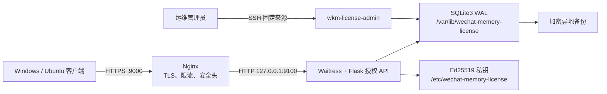
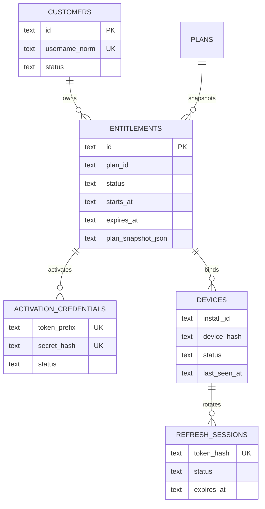
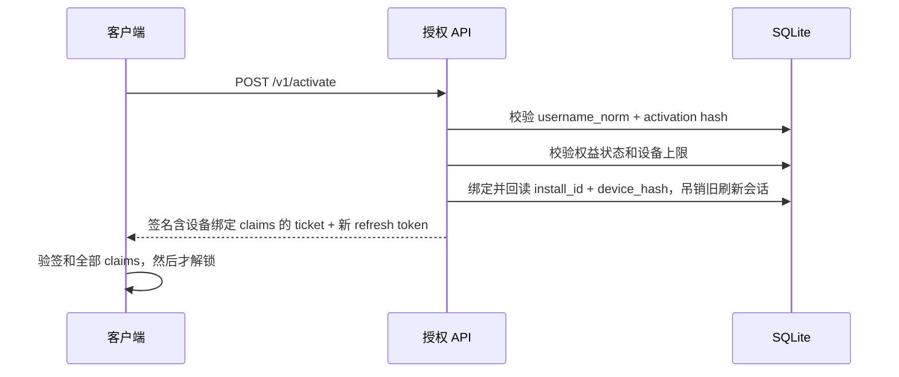

# WeChatMemory 授权服务原理、接口与运维设计

> 基线：License Server `0.2.3` / Client `0.3.3`
> 公网入口：`https://104.224.90.172:9000`
> 存储：单机 SQLite3，客户聊天数据不上云。
> 文档导航见 [`README.md`](README.md)，生产操作见
> [`SERVER_OPERATIONS_RUNBOOK.md`](SERVER_OPERATIONS_RUNBOOK.md)。

## 1. 服务端仅解决什么问题

服务端只回答三件事：

1. “这个账号 + 激活码”是否对应一条有效权益；
2. 该权益是否还能绑定当前匿名设备；
3. 客户端当前可以使用哪些 capability，并用 Ed25519 签名防止客户端篡改。

它不保存、不处理、不传输聊天正文、图片、语音、视频、联系人、wxid、微信数据库密钥和搜索词。

## 2. 总体架构



- Nginx 是唯一监听公网 `9000` 的进程。
- Python 应用只监听 `127.0.0.1:9100`，以 `wkm-license` 非 root 用户运行。
- SQLite 只在本地持久磁盘，不放在 NFS/SMB，不对公网开放。
- 签名私钥不进入 Git、SQLite、容器镜像、日志或备份明文。当前文件基线可在上线后迁移到 KMS/HSM。

## 3. 数据模型



| 表 | 作用 | 关键安全属性 |
|---|---|---|
| `customers` | 云端账号 | 不要求真实邮箱/手机，大小写归一化后唯一 |
| `plans` | 套餐模板 | 保存设备上限、离线天数、capability 模板 |
| `entitlements` | 某个客户的实际权益 | 保存销售时套餐快照，后续修改套餐不改变已售权益 |
| `activation_credentials` | 首次激活凭据 | 只保存命名空间 SHA-256 摘要和前缀，明文只显示一次 |
| `devices` | 权益与匿名安装的绑定 | 只存随机 install ID 和匿名摘要，不存硬件原值 |
| `refresh_sessions` | 设备刷新会话 | 只存 token 摘要；每次成功刷新都轮换；旧 `rotated/revoked` 默认保留 90 天后有界清理，`active` 永不清理 |
| `audit_events` | 授权安全审计 | 记录事件类型和内部 ID，不记录激活码/token/聊天数据 |

SQLite 强制外键、WAL、`synchronous=FULL`、5 秒 busy timeout；写入使用短 `BEGIN IMMEDIATE` 事务。

## 4. 套餐基线

| 套餐 | 设备上限 | 离线期 | 主要能力 |
|---|---:|---:|---|
| `free` | 1 | 30 天 | 查看、手动同步、单会话导出、设置 |
| `permanent_personal` | 2 | 180 天 | 个人永久权益、近实时同步、分类导出、基础统计 |
| `pro_subscription` | 3 | 30 天 | 专业订阅、多账号、批量导出、高级分析 |

当权益过期、被吊销或超出离线期时，服务端只签发 `read_only`；客户端不删除个人档案。

## 5. 主要请求流程

### 5.1 创建用户（管理员）

```bash
sudo wkm-license-admin add \
  --username customer-demo --plan permanent_personal
```

脚本只在当次标准输出显示一次激活码。不能从 SQLite 恢复明文；丢失后应吊销旧凭据并创建新码，
不应把终端输出写入 CI 或工单日志。

### 5.2 首次激活



### 5.3 打开界面时刷新

客户端先使用已验签的本地票据判定界面状态，然后在后台调用 `POST /v1/licenses/refresh`。成功后服务端将旧
refresh token 原子标记为 `rotated`，生成新 token 和新票据。这能检测旧 token 重放，也让吊销在下次在线刷新时生效。
激活、刷新和状态查询签发的 ticket 都必须包含 `device_id`、`install_id` 与 `device_hash`；三者只取自
已验证的 `devices` 行或 refresh-session 联表结果，不能把未经行绑定验证的请求字段直接放入签名 claims。

### 5.4 refresh session 保留与清理

轮换和吊销记录需要保留一段时间用于重放拒绝、事故调查和审计，但不能无限增长。schema v3 为
`rotated_at` 与 `revoked_at` 建立状态专用部分索引。每日备份任务只在一致备份完成并通过完整性检查后，
调用本机管理员命令执行清理：默认保留 90 天，每批最多 500 条、每次最多 20 批。

删除谓词必须同时满足：状态为 `rotated` 且 `rotated_at` 早于截止时间，或状态为 `revoked` 且
`revoked_at` 早于截止时间。`active`、`expired`、近期终态和缺少终态时间戳的行不在删除集合内。
每批使用短 `BEGIN IMMEDIATE` 事务，候选查询带 `LIMIT`，删除时再次验证状态和时间；并发维护由
SQLite 写锁串行化。API 请求路径不运行维护查询。
该策略不删除 `audit_events`；会话清理本身反而按批写入脱敏审计事件。审计日志的保留、加密归档与
删除期限属于独立合规策略，必须另行审批，不能借会话清理悄悄移除证据。

## 6. HTTP API

| 方法 | 路径 | 用途 | 是否需要秘密 |
|---|---|---|---|
| GET | `/healthz` | 进程健康 | 否 |
| GET | `/readyz` | 廉价的 SQLite schema/可用性检查 | 否，受应用限流 |
| GET | `/readyz/deep` | SQLite `quick_check` 深度检查 | 否，仅 loopback，Nginx 明确返回 404 |
| GET | `/v1/time` | 服务端 UTC 时间 | 否，受应用限流 |
| GET | `/v1/keys` | 当前 Ed25519 公钥元数据 | 否，受应用限流；客户端仍只信任内置公钥 |
| POST | `/v1/activate` | 首次激活/同安装重新激活 | 账号 + 激活码 |
| POST | `/v1/licenses/refresh` | 轮换刷新会话并签发新票据 | refresh token |
| GET | `/v1/licenses/status` | 查看当前签名权益 | Bearer refresh token |
| POST | `/v1/devices/deactivate` | 解绑当前设备 | refresh token |

请求体最大 16 KiB。除廉价 liveness `/healthz` 外，公网 API（包括 `/readyz`、`/v1/time`
和 `/v1/keys`）都执行单 IP 和进程全局滑动窗口限流；`/readyz/deep` 只允许直接 loopback。
响应返回 `Cache-Control: no-store`、CSP、`nosniff` 和 `no-referrer`。Nginx 还应做第二层限流。
当前是单进程内存限流，多实例时要替换为共享限流后端。

## 7. 环境配置

`/etc/wechat-memory-license/service.env`：

```ini
DATABASE_PATH=/var/lib/wechat-memory-license/license.sqlite3
LICENSE_ISSUER=wechat-memory-license
LICENSE_AUDIENCE=wechat-memory-client
REFRESH_TOKEN_DAYS=365
LICENSE_TICKET_HOURS=24
RATE_LIMIT_PER_MINUTE=20
RATE_LIMIT_GLOBAL_PER_MINUTE=1000
RATE_LIMIT_MAX_KEYS=4096
SIGNING_KEY_ID=2026-10-30
SIGNING_PRIVATE_KEY_PATH=/etc/wechat-memory-license/signing-ed25519-2026-10-30.pem
SIGNING_PUBLIC_KEYS_PATH=/opt/wechat-memory-license/current/config/signing-public-keys.json
```

Waitress 的监听地址固定在 systemd 单元的 `127.0.0.1:9100`，不由 `service.env`
覆盖。公网 IP、端口和 URL 由部署参数与 Nginx 配置管理；未接入运行时的配置项不写入环境文件。

`LICENSE_TICKET_HOURS` 是在线票据时长，不是用户套餐有效期。服务端会把订阅票据截断在权益到期时间内。
`REFRESH_TOKEN_DAYS` 是设备刷新凭据最长生命周期，到期后需重新输入激活码。
`RATE_LIMIT_GLOBAL_PER_MINUTE` 是单进程全局上限，`RATE_LIMIT_MAX_KEYS` 约束活跃 IP 窗口表大小；
多进程/多实例部署仍需共享限流后端或上游网关保护。

数值配置启动时失败关闭：`REFRESH_TOKEN_DAYS` 为 1～3,650，`LICENSE_TICKET_HOURS` 为
1～720，`RATE_LIMIT_PER_MINUTE` 为 1～10,000，`RATE_LIMIT_GLOBAL_PER_MINUTE` 为
1～1,000,000 且不得小于每源上限，`RATE_LIMIT_MAX_KEYS` 为 1～100,000。非整数或越界值
不会静默回退默认值。

## 8. 发布、备份和回滚

1. 在开发环境执行单元测试、Shell 语法和文档契约检查。
2. 只把已审核变更提交到 `main`；服务器 `/data/WeChatMemory-LicenseServer` 保持干净。
3. 运行 `deploy/el9/deploy-from-data.sh`；它执行 fast-forward、SQLite `.backup`、完整性检查、
   不可变 release 创建、`requirements.lock` 精确约束、release 内独立 `.venv` 安装、
   SBOM/全测/严格编译/Shell/事务门禁、migration ledger 原生 SQL/旧库结构合同 SHA-256 校验、
   `current` 原子切换和 systemd 重启。
4. 候选服务启动、本机 `/readyz/deep`、Nginx 切换或公网验收失败时，补偿事务恢复
   `current`、`service.env`、systemd 单元/服务状态、Nginx 配置/服务状态，以及 existing 模式
   覆盖前的 TLS 证书与私钥。
5. SQLite migration 不在服务可能发生新写入后自动降级；日志会指向升级前一致备份和人工恢复边界。
6. 最后检查公网 HTTPS 证书、`/healthz`、`/v1/keys`、SQLite 以及专用验收用户。

备份必须加密后异地保存，并定期真实恢复；单纯“备份文件存在”不是可恢复性证据。

## 9. 监控与报警

- HTTPS 证书剩余 48 小时报警；IP 短期证书必须自动续期。
- 监控 `/healthz` 和 `/readyz`、请求 P95、HTTP 5xx/429、激活失败异常激增。
- 监控磁盘、SQLite WAL 大小、checkpoint、busy/locked 比例和备份年龄。
- 监控 `refresh_sessions` 各状态数量、每日清理条数和 `more_remaining`；持续积压时分次运行有界命令，不能取消上限。
- 监控 `audit_events` 行数、数据库占用和增长率；在容量阈值前设计经过法律/合规审批的不可篡改归档，当前版本不自动删除审计事件。
- 日志不记录 request body、Authorization、refresh token、激活码、完整设备摘要。
- 日志包含异常堆栈时要做统一脱敏，不能直接打印 Flask request。

## 10. 未来的管理 Web

当前交付是 API + SQLite + 管理员命令行注册脚本，尚未把管理 Web 暴露到公网。后续管理 Web 应当作为独立信任域：

- 独立管理员账号、MFA、CSRF、会话过期和 IP/VPN 限制；
- 支持创建用户、生成/吊销激活码、暂停权益、解绑设备、查看脱敏审计；
- 不处理支付，不验证邮箱/手机真实性，不能查看客户端聊天数据；
- 不与客户端 API 共享浏览器 Cookie 或管理员会话。

## 11. 当前交付状态

- 已完成：SQLite schema v3、套餐快照、注册脚本、激活、设备上限、refresh token 轮换、吊销、终态会话有界保留清理、Ed25519 票据、限流、systemd/Nginx 部署素材和自动化测试。
- 已完成：客户端 `0.3.3` 激活页、未激活锁定、内置公钥验签、公钥清单生成、后台刷新、到期只读和 capability gate。
- 待完成：已具备 SSH 管理入口，需在 `104.224.90.172` 上执行 `/data/WeChatMemory-LicenseServer/deploy/el9/deploy-from-data.sh`，并完成激活、刷新、吊销、离线和备份恢复验收。
