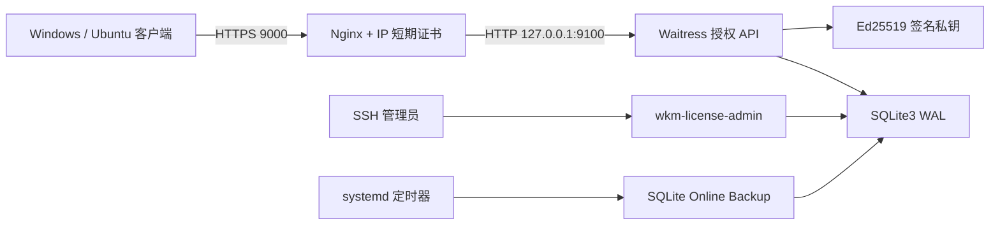

# 授权服务一键部署与用户授权运维手册

> 目标：Enterprise Linux 9，公网 `https://104.224.90.172:9000`
> 架构：Nginx TLS → `127.0.0.1:9100` 授权 API → 本机 SQLite3
> 适用：首次安装、后续升级、新增用户、套餐调整、续期、停用和设备解绑
> 文档导航见 [`README.md`](README.md)，值班、完整恢复和回滚见
> [`SERVER_OPERATIONS_RUNBOOK.md`](SERVER_OPERATIONS_RUNBOOK.md)。

## 1. 一次性部署结构



服务端只接收用户名、激活码摘要、匿名设备标识、客户端版本和授权状态。聊天正文、图片、视频、语音、
联系人、搜索词和微信数据库密钥不得上传。

## 2. 部署前必须准备

1. 服务器运行 RHEL 9、Rocky Linux 9、AlmaLinux 9、Oracle Linux 9 或 CentOS Stream 9；
2. 云安全组和服务器都允许公网访问 `80/tcp`、`9000/tcp`；
3. `104.224.90.172` 直接绑定当前服务器，80 端口没有被其他代理占用；
4. 已通过 SSH 登录，当前账号具备 `sudo` 权限；
5. 已准备运维邮箱；
6. 证书通知与运维邮箱为 `gladlygrady@tutamail.com`；
7. 已把与客户端公钥配对的 Ed25519 私钥安全上传到服务器，例如：
8. **首次正式签发前的强制人工门禁**：必须先按
   [手工部署 6.2](MANUAL_DEPLOY_EL9_IP_CERT.md#62-多业务服务器的无损-acme-排错)
   在本机用 Host 头验证专属 webroot，再从服务器之外的电脑或移动网络访问同一探针并保存结果。
   本机成功不能证明云安全组、EIP/NAT 和上游 ACL 允许 CA 访问；外部探针未成功时禁止运行正式 Certbot。

```text
/root/wkm-signing-ed25519.pem
```

该私钥不能进入 Git、聊天软件、工单、普通备份或 Shell 输出。建议先执行：

```bash
sudo chown root:root /root/wkm-signing-ed25519.pem
sudo chmod 0600 /root/wkm-signing-ed25519.pem
```

若匹配私钥尚在受控 Ubuntu 开发机的 `.secrets` 目录，可通过已验证的 SSH
通道分两步暂存和安装。下面命令不会在目标已存在时覆盖它：

```bash
# 只在保存匹配私钥的 Ubuntu 开发机上执行
scp WeChatMemory-LicenseServer/.secrets/signing-ed25519.pem \
  root@104.224.90.172:/root/.wkm-signing-ed25519.upload
ssh root@104.224.90.172 \
  'set -eu; umask 077; trap "rm -f /root/.wkm-signing-ed25519.upload" EXIT; \
   test ! -e /root/wkm-signing-ed25519.pem; \
   openssl pkey -in /root/.wkm-signing-ed25519.upload -check -noout; \
   install -o root -g root -m 0600 /root/.wkm-signing-ed25519.upload \
     /root/wkm-signing-ed25519.pem'
```

如果第二步因目标已存在而退出，不要删除或覆盖旧文件；先执行公钥指纹核对。
暂存 `.upload` 文件会由远程 `trap` 在成功或失败时清理。

Let's Encrypt 的 IP 地址证书必须使用短期证书配置。Certbot 需要 5.4 或更高版本；本仓库默认固定
`5.9.0`。一键部署同时校验 `x.y.z` 格式和数值下限，格式正确但低于 `5.4.0` 也会失败关闭。
证书约 160 小时有效，续期自动化是生产必需条件。官方说明：

- <https://letsencrypt.org/2026/03/11/shorter-certs-certbot>
- <https://letsencrypt.org/ca/docs/profiles/>

## 3. 首次一键部署

### 3.1 获取服务器代码到 `/data`

在服务器 SSH 终端执行：

```bash
sudo install -d -o root -g root -m 0755 /data
sudo git clone https://github.com/gladlyknow/WeChatMemory-LicenseServer.git \
  /data/WeChatMemory-LicenseServer
cd /data/WeChatMemory-LicenseServer
git status --short
git rev-parse --short HEAD
```

私有仓库应使用只具备该仓库读取权限的 deploy key 或 fine-grained token，不要使用个人全权限 token。

`/data/WeChatMemory-LicenseServer` 是可审计的源码检出目录，不存放生产私钥、
SQLite 数据库或运行日志。实际发布版、状态和密钥仍分别位于 `/opt`、`/var/lib`和
`/etc`，避免 `git pull` 触及生产数据。

### 3.2 从 `/data` 执行一键部署（推荐）

```bash
cd /data/WeChatMemory-LicenseServer

sudo bash deploy/el9/deploy-from-data.sh \
  --signing-key /root/wkm-signing-ed25519.pem \
  --firewall-zone public
```

`public` 只是示例；必须使用公网网卡实际所属 zone。只有一个活动 zone 时可省略该参数；
检测到多个 zone 时脚本会失败关闭，不会把入站规则批量加到多个网络。

该入口默认执行 `origin/main` fast-forward，并固定：

- 源码目录：`/data/WeChatMemory-LicenseServer`；
- 运维邮箱：`gladlygrady@tutamail.com`；
- 公网入口：`104.224.90.172:9000`；
- 分支：`main`；
- 只允许干净工作树。

如果已在 SSH 会话中人工审核并更新代码，可加 `--skip-update`。

### 3.3 直接执行底层部署器

底层入口也可显式传入已确认的运维邮箱：

```bash
cd /data/WeChatMemory-LicenseServer

sudo bash deploy/el9/one-click-deploy.sh \
  --source "$PWD" \
  --signing-key /root/wkm-signing-ed25519.pem \
  --key-id 2026-10-30 \
  --email gladlygrady@tutamail.com \
  --public-ip 104.224.90.172 \
  --public-port 9000 \
  --firewall-zone public
```

脚本会自动完成：

1. 校验 EL9、IPv4、端口、源码，并反向计算签名私钥的公钥，确认它与仓库跟踪的公开清单一致；
2. 安装 Nginx、SQLite、Python 3.11、firewalld、SELinux 工具和项目专属 Certbot 环境；
3. 创建 `wkm-license` 无登录系统账号；
4. 在唯一的活动 firewalld zone 中精确增加规则（不全量 reload），配置 SELinux 和专属 ACME webroot；
5. 申请包含 `104.224.90.172` IP SAN 的受信任短期证书；
6. 安装每四小时运行、只续期本 IP 证书的专属定时器；
7. 创建不可变候选 release 源码目录；
8. 对旧库创建并校验 SQLite 一致备份；
9. 在候选 release 内扫描私钥标记，建立独立 `.venv`，验证依赖闭包与精确 SBOM，强制执行严格编译、服务端全测、全部 EL9 Shell 语法和部署事务自测，校验签名私钥后再执行 SQLite init/migration；
10. 安装 systemd 单元和每日备份定时器，原子切换 `current`，启动授权服务并通过本机 `/readyz/deep`；
11. 切换 Nginx 生产配置，验证公网 HTTPS、证书 SAN、`/readyz` 和签名公钥接口。

在同机多业务环境，脚本只拥有
`/etc/nginx/conf.d/wechat-memory-license.conf`：

- 不删除、改名或覆盖其他 `conf.d` 文件；
- 若目标文件不含项目 owner marker，也不符合旧版唯一特征，拒绝覆盖；
- 若其他配置已声明 `104.224.90.172` 或监听 `9000`，拒绝抢占；
- 写入前后会校验其他 Nginx 配置的摘要；部署期间它们发生变化就拒绝 reload；
- 已运行的 Nginx 中 ACME 路由已经实际生效时，不做无意义 reload；新配置则先
  `nginx -t`，再热加载，并用本地 Host 头探针验证。

`entityecho.conf` 这类现有站点可以继续共享 `listen 80`，只要 `server_name`
不抢占本项目 IP。部署过程中不要同时修改其他 Nginx 站点；需要修改时先结束本次部署。

脚本不会删除已经存在的数据库。升级前会先通过 SQLite `.backup` 创建一致性备份。候选版本的
本机验收、Nginx 切换或公网验收失败时，脚本会恢复部署前的 `current`、`service.env`、
systemd 单元/服务状态和 Nginx 配置/服务状态；`--tls-mode existing` 还会按字节恢复覆盖前的
固定路径证书与私钥。但候选版本已经执行过的 SQLite migration 不会
在服务可能产生新写入后自动降级；这时日志会明确提示备份和人工恢复边界。
补偿回滚会只撤销本次新增的 firewalld 运行/永久规则、SELinux 端口和布尔值，不执行全局
`firewall-cmd --reload`，也不会改写已属于其他 SELinux 类型的端口。它不卸载系统软件包、删除 Let's Encrypt 已签发证书、
候选 release 或已安全安装但未激活的版本化签名私钥。这些不影响旧版运行态，保留用于取证或下次重试；
确认不再需要后再按明确路径人工清理。进程被 `SIGKILL` 或主机掉电时 Shell 无法执行 EXIT 补偿，
事务快照会保留在 `/etc/wechat-memory-license/.one-click-transaction.*` 或 `.install-transaction.*`。下次部署会
失败关闭，拒绝覆盖这些恢复证据。必须按统一运维手册核对 `current`、`service.env`、systemd、
Nginx 和数据库备份，确认恢复完成后才能移走事务目录并重新开放流量。

可在隔离验收机上通过 `WKM_DEPLOY_ENABLE_FAULT_INJECTION=1` 和
`WKM_DEPLOY_TEST_FAULT=after_application_install|after_nginx_switch` 注入故障。生产日常部署不得设置这两个变量。

### 3.4 使用已有受信任证书

如果已经有包含该公网 IP SAN 的正式证书：

```bash
sudo bash deploy/el9/one-click-deploy.sh \
  --source "$PWD" \
  --signing-key /root/wkm-signing-ed25519.pem \
  --key-id 2026-10-30 \
  --tls-mode existing \
  --tls-cert /root/tls/fullchain.pem \
  --tls-key /root/tls/privkey.pem
```

脚本会拒绝以下证书：

- 48 小时内过期；
- 不包含目标公网 IP SAN；
- 文件不存在或无法读取。

existing 证书会复制到 Nginx 固定路径。复制前脚本捕获旧证书和私钥；证书校验、应用安装、
Nginx 切换或公网验收任一步失败，都会在恢复旧 Nginx 配置并 reload 前先按字节恢复这两个文件。

正式客户端不能使用自签名证书，也不能关闭 TLS 证书校验。

## 4. 部署后验收

```bash
sudo systemctl status wechat-memory-license --no-pager
sudo systemctl status nginx --no-pager
sudo systemctl status wechat-memory-certbot-renew.timer --no-pager
sudo systemctl status wechat-memory-license-backup.timer --no-pager

curl --fail --silent --show-error http://127.0.0.1:9100/readyz/deep
curl --fail --silent --show-error https://104.224.90.172:9000/readyz
curl --fail --silent --show-error https://104.224.90.172:9000/v1/keys
```

检查监听范围：

```bash
sudo ss -lntp | grep -E ':(80|9000|9100)\b'
```

正确结果：

- `80`：Nginx 公网监听，只服务 ACME challenge；
- `9000`：Nginx 公网 HTTPS；
- `9100`：只能是 `127.0.0.1:9100`；
- SQLite 没有网络监听端口。

检查证书：

```bash
sudo openssl x509 \
  -in /etc/letsencrypt/live/104.224.90.172/fullchain.pem \
  -noout -issuer -subject -dates -ext subjectAltName
```

## 5. 后续升级

```bash
cd /data/WeChatMemory-LicenseServer
git pull --ff-only origin main
git rev-parse --short HEAD

sudo bash deploy/el9/deploy-from-data.sh
```

签名私钥和证书已经安装后不需要再次传入。不要随意更换 `key-id` 或签名私钥；客户端必须提前内置
对应公钥，才能完成安全轮换。
完整的密钥创建、公开清单发布、客户端同步、备份和轮换步骤见
[`SIGNING_KEY_OPERATIONS.md`](SIGNING_KEY_OPERATIONS.md)。

## 6. 用户管理入口

部署完成后统一使用：

```bash
sudo wkm-license-admin --help
```

它会以 `wkm-license` 身份访问固定数据库：

```text
/var/lib/wechat-memory-license/license.sqlite3
```

没有开放公网管理 API，避免管理员密码、数据库写权限或批量用户信息暴露到网络。

### 6.1 新增免费用户

```bash
sudo wkm-license-admin add \
  --username demo-user \
  --display-name "演示用户" \
  --plan free
```

### 6.2 新增永久个人版用户

```bash
sudo wkm-license-admin add \
  --username alice \
  --display-name "Alice" \
  --plan permanent_personal
```

### 6.3 新增专业订阅用户

```bash
sudo wkm-license-admin add \
  --username bob \
  --plan pro_subscription \
  --days 365
```

新增或重置后显示的激活码只出现一次。请立即通过安全渠道交付，不要截图到公开群、写入工单、CI 日志
或普通文本文件。数据库只能保存激活码 SHA-256 摘要，服务端无法找回旧激活码。

### 6.4 查看用户

```bash
sudo wkm-license-admin list
sudo wkm-license-admin show --username alice
sudo wkm-license-admin devices --username alice
```

需要机器可读输出时，`--json` 必须放在子命令前：

```bash
sudo wkm-license-admin --json show --username alice
```

包含一次性激活码的 JSON 不应进入自动化日志。

## 7. 套餐、期限和额度调整

### 7.1 免费版升级为永久个人版

```bash
sudo wkm-license-admin set-plan \
  --username alice \
  --plan permanent_personal
```

### 7.2 更换为一年专业订阅

```bash
sudo wkm-license-admin set-plan \
  --username alice \
  --plan pro_subscription \
  --days 365
```

`set-plan --days` 表示从执行时刻重新计算订阅期限，不表示在旧期限上追加。追加期限应使用 `extend`。

### 7.3 延长订阅

```bash
sudo wkm-license-admin extend --username alice --days 90
```

如果旧授权仍未到期，从原到期日追加；如果已经到期，从当前时间追加，并恢复为 `active`。

### 7.4 单独调整设备数和离线期限

```bash
sudo wkm-license-admin set-limits \
  --username alice \
  --device-limit 5 \
  --offline-days 45
```

如果把设备上限降低到当前活跃设备数以下，命令默认失败，避免静默踢掉用户设备。确认按“保留最近活跃
设备”处理时显式执行：

```bash
sudo wkm-license-admin set-limits \
  --username alice \
  --device-limit 1 \
  --deactivate-excess
```

套餐、设备数、离线期限和功能集以权益快照保存，只影响指定用户，不会修改其他已售用户。

## 8. 暂停、到期、撤销和恢复

```bash
sudo wkm-license-admin set-status --username alice --status suspended
sudo wkm-license-admin set-status --username alice --status expired
sudo wkm-license-admin set-status --username alice --status revoked
sudo wkm-license-admin set-status --username alice --status active
```

状态含义：

| 状态 | 客户端行为 |
|---|---|
| `active` | 按套餐能力运行 |
| `suspended` | 下一次在线刷新后只读 |
| `expired` | 下一次在线刷新后只读 |
| `revoked` | 下一次在线刷新后只读，表示管理员撤销 |

过期订阅不能直接设为 `active`，必须先使用 `extend`。客户端已有的离线票据无法在完全离线时被远程
即时收回；这是离线授权的固有限制。高风险设备应同时执行设备封禁。

整账号停用和恢复：

```bash
sudo wkm-license-admin set-user-status --username alice --status disabled
sudo wkm-license-admin set-user-status --username alice --status active
```

## 9. 激活码重置

默认吊销旧激活码、生成新激活码，并撤销当前设备刷新会话：

```bash
sudo wkm-license-admin reset-code --username alice
```

用户需要使用新激活码重新激活。如果只是遗失激活码、确认现有设备可信，可保留设备会话：

```bash
sudo wkm-license-admin reset-code --username alice --keep-sessions
```

审计日志只记录“发生了重置”和是否撤销会话，不记录新旧激活码明文。

## 10. 设备解绑和封禁

先查询设备 ID：

```bash
sudo wkm-license-admin devices --username alice
```

解绑设备：

```bash
read -r -p '请输入要解绑的完整设备 ID：' WKM_DEVICE_ID
if [[ ! "${WKM_DEVICE_ID}" =~ ^[0-9A-Fa-f-]{36}$ ]]; then
  echo '设备 ID 格式不合法' >&2; exit 2
fi
sudo wkm-license-admin device-status \
  --username alice \
  --device-id "${WKM_DEVICE_ID}" \
  --status deactivated
```

封禁疑似被盗设备：

```bash
read -r -p '请输入要封禁的完整设备 ID：' WKM_DEVICE_ID
if [[ ! "${WKM_DEVICE_ID}" =~ ^[0-9A-Fa-f-]{36}$ ]]; then
  echo '设备 ID 格式不合法' >&2; exit 2
fi
sudo wkm-license-admin device-status \
  --username alice \
  --device-id "${WKM_DEVICE_ID}" \
  --status blocked
```

恢复设备：

```bash
read -r -p '请输入要恢复的完整设备 ID：' WKM_DEVICE_ID
if [[ ! "${WKM_DEVICE_ID}" =~ ^[0-9A-Fa-f-]{36}$ ]]; then
  echo '设备 ID 格式不合法' >&2; exit 2
fi
sudo wkm-license-admin device-status \
  --username alice \
  --device-id "${WKM_DEVICE_ID}" \
  --status active
```

解绑或封禁会立即撤销该设备当前 refresh token。普通激活请求不能解除 `blocked`；只能由管理员显式
恢复。`deactivated` 设备重新激活和管理员恢复都必须重新检查设备数量上限。

## 11. refresh session 保留清理

旧 refresh token 的摘要需要短期保留以拒绝重放和支持审计，但 `rotated/revoked` 行不能无限增长。
默认保留 90 天，手工命令如下：

```bash
sudo wkm-license-admin --json prune-refresh-sessions \
  --retention-days 90 \
  --batch-size 500 \
  --max-batches 20
```

命令只删除超过保留期且终态时间有效的 `rotated/revoked`；不会删除 `active`、`expired`、近期终态
或时间戳缺失的行。每批是独立短事务，固定最多 500 条；一次最多 100 批，默认 20 批。返回
`more_remaining=true` 时分次重跑，不要绕过上限。

每日备份 timer 会在一致备份完成并校验后自动执行默认清理。可通过
`wechat-memory-license-backup.service` 的 systemd drop-in 设置：

- `REFRESH_SESSION_RETENTION_DAYS`；
- `REFRESH_SESSION_PRUNE_BATCH_SIZE`；
- `REFRESH_SESSION_PRUNE_MAX_BATCHES`。

建议先保留默认值，观察一周各状态行数和清理日志后再调整。
清理不会删除 `audit_events`；审计证据的保留与归档是独立合规工作，当前版本仅监控容量，不自动删除。

## 12. 数据库备份和恢复

每日 UTC 03:15 自动执行 SQLite `.backup`，完整性通过后才执行上述终态会话清理：

```bash
sudo systemctl list-timers wechat-memory-license-backup.timer
sudo systemctl start wechat-memory-license-backup.service
sudo journalctl -u wechat-memory-license-backup.service -n 50 --no-pager
sudo ls -l /var/lib/wechat-memory-license/backups
```

本机备份默认保留 30 天。本机备份不能替代加密异地备份；应把备份文件加密后同步到独立存储，并定期
实际恢复演练。

恢复前必须确认备份完整，并停止写入：

```bash
read -r -p '请输入要验证的备份文件名：' WKM_BACKUP_NAME
if [[ ! "${WKM_BACKUP_NAME}" =~ ^license-[0-9]{8}T[0-9]{6}Z(-[0-9]+)?\.sqlite3$ ]]; then
  echo '备份文件名格式不合法' >&2; exit 2
fi
sudo -u wkm-license sqlite3 \
  "/var/lib/wechat-memory-license/backups/${WKM_BACKUP_NAME}" \
  'PRAGMA integrity_check;'
```

恢复属于高风险操作，应先保留当前数据库，再使用 SQLite `.restore`，完成后重新检查完整性、文件权限
和仅本机可访问的 `/readyz/deep`。不要在服务运行时直接复制单独的 `.sqlite3` 文件，因为 WAL 中可能仍有未合并数据。
可执行的停服务恢复、原数据保留和恢复失败回退步骤见
[`SERVER_OPERATIONS_RUNBOOK.md`](SERVER_OPERATIONS_RUNBOOK.md#62-数据库恢复)。

## 13. 日志和故障排查

授权服务日志：

```bash
sudo journalctl -u wechat-memory-license -n 200 --no-pager
sudo journalctl -u wechat-memory-license --since '30 minutes ago'
```

Nginx 日志：

```bash
sudo tail -n 100 /var/log/nginx/wechat-memory-license.error.log
sudo tail -n 100 /var/log/nginx/wechat-memory-license.access.log
```

证书续期：

```bash
sudo systemctl status wechat-memory-certbot-renew.timer --no-pager
sudo journalctl -u wechat-memory-certbot-renew.service --since '24 hours ago'
sudo /opt/wechat-memory-license-certbot/bin/certbot renew --dry-run \
  --cert-name 104.224.90.172 \
  --deploy-hook /usr/local/sbin/wkm-certbot-deploy
```

SQLite：

```bash
sudo -u wkm-license sqlite3 /var/lib/wechat-memory-license/license.sqlite3 \
  'PRAGMA integrity_check; PRAGMA journal_mode; PRAGMA foreign_keys;'
```

## 14. 重要目录

| 路径 | 用途 |
|---|---|
| `/opt/wechat-memory-license/releases/` | 不可变发布版本；每个 release 自带独立 `.venv` |
| `/opt/wechat-memory-license/current` | 当前版本符号链接 |
| `/opt/wechat-memory-license/current/.venv` | 当前 release 的 Python 环境；不与其他 release 共享 |
| `/etc/wechat-memory-license/service.env` | 服务配置 |
| `/etc/wechat-memory-license/signing-ed25519-<key-id>.pem` | 按 key-id 版本化的 Ed25519 私钥 |
| `/var/lib/wechat-memory-license/license.sqlite3` | 授权数据库 |
| `/var/lib/wechat-memory-license/backups/` | 本机一致性备份 |
| `/usr/local/sbin/wkm-license-admin` | 用户管理入口 |
| `/var/log/nginx/wechat-memory-license.*` | 公网代理日志 |

## 15. 上线安全检查

- [ ] 9100 未对公网开放；
- [ ] 9000 使用受信任且包含公网 IP SAN 的证书；
- [ ] Certbot 续期 timer 正常；
- [ ] SQLite 仅 `wkm-license` 可写；
- [ ] 签名私钥不在 Git 和普通备份中；
- [ ] 日志中没有激活码、refresh token 或数据库密钥；
- [ ] 每日备份可用且存在加密异地副本；
- [ ] 免费、永久、订阅、过期、暂停、设备超限均完成真机验收；
- [ ] 客户端内置公钥与 `/v1/keys` 完全一致。
