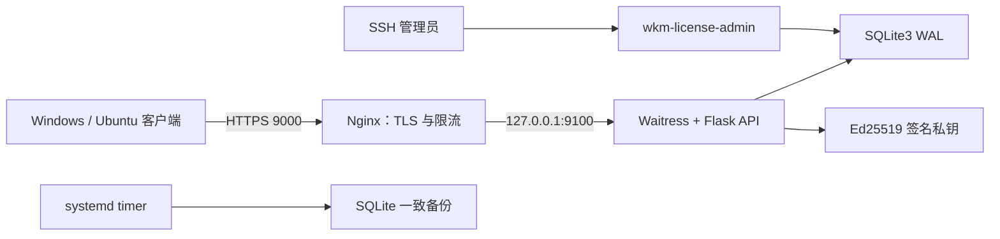

# WeChatMemory 授权服务统一运维手册

> 适用：Enterprise Linux 9，源码 `/data/WeChatMemory-LicenseServer`，
> 公网 `https://104.224.90.172:9000`，邮箱 `gladlygrady@tutamail.com`。
> 本文是值班人员的统一入口；密钥轮换等高风险操作会链接到专题手册。

## 1. 系统做什么

授权服务只管理账号、激活凭据摘要、匿名设备、套餐权益、refresh session 和
Ed25519 签名票据。它不存储微信聊天正文、图片、语音、视频、联系人、搜索词和微信
数据库密钥。



当前没有公网管理 Web，也没有 `/admin` 路由。用户和设备管理只能通过 SSH 后的
`sudo wkm-license-admin` 完成。

## 2. 运行目录与服务

| 路径或单元 | 作用 | 备注 |
|---|---|---|
| `/data/WeChatMemory-LicenseServer` | 干净的 `main` 源码工作树 | 不放私钥、数据库、日志 |
| `/opt/wechat-memory-license/releases` | 不可变发布版 | 每次部署新建目录 |
| `/opt/wechat-memory-license/current` | 当前发布软链接 | 原子切换 |
| `/opt/wechat-memory-license/venv` | 共享 Python 3.11 环境 | 由部署器维护 |
| `/etc/wechat-memory-license/service.env` | 应用配置 | `root:wkm-license 0640` |
| `/etc/wechat-memory-license/signing-ed25519-<key-id>.pem` | 签名私钥 | 不进 Git/SQLite/普通备份 |
| `/var/lib/wechat-memory-license/license.sqlite3` | 授权数据库 | 本机磁盘 |
| `/var/lib/wechat-memory-license/backups` | 每日一致备份 | 默认保留 30 天 |
| `wechat-memory-license.service` | 授权 API | 非 root 运行 |
| `wechat-memory-license-backup.timer` | 数据库备份 | UTC 03:15，随机延迟 20 分钟 |
| `certbot-renew.timer` | IP 短证书续期检查 | 每 4 小时 |

## 3. 首次部署

### 3.1 前置检查

- 云安全组与 firewalld 允许 `80/tcp` 和 `9000/tcp`；
- `22/tcp` 限定管理来源；`9100/tcp` 不对公网开放；
- `104.224.90.172` 指向本机，80 端口可用于 ACME HTTP-01；
- 已安全准备与跟踪公钥清单匹配的 `/root/wkm-signing-ed25519.pem`；
- 系统时间同步正常，磁盘不是 NFS/SMB。

私钥权限：

```bash
sudo chown root:root /root/wkm-signing-ed25519.pem
sudo chmod 0600 /root/wkm-signing-ed25519.pem
```

不要在服务器上使用相同 `key_id` 临时生成一把新私钥。丢失当前私钥时必须从加密
离线备份恢复。

### 3.2 获取代码并部署

```bash
sudo install -d -o root -g root -m 0755 /data
sudo git clone https://github.com/gladlyknow/WeChatMemory-LicenseServer.git \
  /data/WeChatMemory-LicenseServer
cd /data/WeChatMemory-LicenseServer
git status --short
git branch --show-current

sudo bash deploy/el9/deploy-from-data.sh \
  --signing-key /root/wkm-signing-ed25519.pem
```

入口脚本默认使用：

- `/data/WeChatMemory-LicenseServer`；
- `104.224.90.172:9000`；
- `gladlygrady@tutamail.com`；
- `key-id=2026-10-30`；
- `origin/main` 的 fast-forward 更新。

脚本只允许干净的 `main` 工作树。发布器对 Git 工作树使用 `git archive HEAD`，因此未提交的
修改既不会也不应进入生产发布。

### 3.3 部署后验收

```bash
sudo systemctl is-active wechat-memory-license
sudo systemctl is-active nginx
sudo systemctl is-enabled wechat-memory-license-backup.timer
sudo systemctl is-enabled certbot-renew.timer

curl --fail --silent --show-error http://127.0.0.1:9100/readyz
curl --fail --silent --show-error https://104.224.90.172:9000/readyz
curl --fail --silent --show-error https://104.224.90.172:9000/v1/keys

sudo -u wkm-license sqlite3 \
  /var/lib/wechat-memory-license/license.sqlite3 \
  'PRAGMA integrity_check; PRAGMA journal_mode; PRAGMA foreign_keys;'
sudo ss -lntp | grep -E ':(80|9000|9100)\b'
```

验收标准：数据库完整性为 `ok`，日志模式为 `wal`，9000 为 Nginx HTTPS，9100 只绑定
`127.0.0.1`，`/v1/keys` 的 `active_key_id` 与客户端内置清单一致。

## 4. 日常升级和回滚

### 4.1 升级

```bash
cd /data/WeChatMemory-LicenseServer
git status --short
sudo bash deploy/el9/deploy-from-data.sh
```

一键入口在任何 Nginx 配置修改前先校验源码文档契约。发布器随后从已提交的
`HEAD` 创建新 release，再次校验 release 内文档，然后通过 SQLite `.backup` 生成并校验
一致备份。备份成功后才更新共享 Python 环境、校验签名私钥、写入新配置、原子切换
`current`、重启服务并检查本机 `/readyz`。

已有通过校验的 Nginx 生产配置时，升级过程不会先切换到 bootstrap；最终替换 Nginx 配置后
任何后续命令失败或脚本显式退出，EXIT trap 会恢复原配置并重新加载。应用启动或本机健康检查失败时，
`install-release.sh` 会同时回滚 `current` 和 `service.env`。

风险：

- 自动回滚只覆盖部署过程中的启动失败，不替代业务回归测试；
- 数据库如有未来的不可逆 schema 迁移，必须配合部署前备份恢复；
- 密钥轮换不属于普通升级，必须使用专题流程。

### 4.2 已成功上线后的人工代码回滚

先记录当前指向并查找上一版：

```bash
readlink -f /opt/wechat-memory-license/current
sudo ls -1dt /opt/wechat-memory-license/releases/* | head -n 5
```

仅在确认目标 release 与当前数据库 schema、`service.env` 和签名密钥兼容后，才原子切换：

```bash
read -r -p '请输入已确认的上一版 release 完整路径：' WKM_PREVIOUS_RELEASE
WKM_PREVIOUS_RELEASE="$(readlink -f -- "${WKM_PREVIOUS_RELEASE}")"
case "${WKM_PREVIOUS_RELEASE}" in
  /opt/wechat-memory-license/releases/*) ;;
  *) echo 'release 路径不在受控目录' >&2; exit 2 ;;
esac
if [[ ! -d "${WKM_PREVIOUS_RELEASE}" ]]; then
  echo 'release 目录不存在' >&2; exit 2
fi
sudo ln -sfn "${WKM_PREVIOUS_RELEASE}" \
  /opt/wechat-memory-license/current.rollback
sudo mv -Tf /opt/wechat-memory-license/current.rollback \
  /opt/wechat-memory-license/current
sudo systemctl restart wechat-memory-license
curl --fail --silent --show-error http://127.0.0.1:9100/readyz
```

若上一次发布包含密钥切换或不可逆数据库变更，不得只回滚软链接；必须同时恢复
匹配的 `service.env`、私钥选择和 SQLite 备份。

## 5. 用户和授权管理

统一入口：

```bash
sudo wkm-license-admin --help
```

常用命令：

```bash
# 免费版
sudo wkm-license-admin add --username demo-user --plan free

# 永久个人版
sudo wkm-license-admin add \
  --username alice --display-name "Alice" --plan permanent_personal

# 365 天专业订阅
sudo wkm-license-admin add \
  --username bob --plan pro_subscription --days 365

# 查询
sudo wkm-license-admin list
sudo wkm-license-admin show --username alice
sudo wkm-license-admin devices --username alice

# 套餐、限额和续期
sudo wkm-license-admin set-plan \
  --username alice --plan pro_subscription --days 365
sudo wkm-license-admin set-limits \
  --username alice --device-limit 2 --offline-days 30
sudo wkm-license-admin extend --username alice --days 90

# 暂停、恢复和重置激活码
sudo wkm-license-admin set-status --username alice --status suspended
sudo wkm-license-admin set-status --username alice --status active
sudo wkm-license-admin reset-code --username alice
```

新增或重置时的激活码只显示一次，不得进入 Shell 输出采集、CI、工单或普通文本文件。
降低设备上限且已有超额设备时，命令会拒绝；只有经确认才使用 `--deactivate-excess`。
所有完整命令与状态语义见 [一键部署与用户授权](ONE_CLICK_DEPLOY_AND_ADMIN.md)。

## 6. 备份、恢复和恢复回退

### 6.1 日常备份验收

```bash
sudo systemctl list-timers wechat-memory-license-backup.timer --no-pager
sudo systemctl start wechat-memory-license-backup.service
sudo journalctl -u wechat-memory-license-backup.service -n 50 --no-pager
sudo ls -lh /var/lib/wechat-memory-license/backups
read -r -p '请输入要验证的备份文件名：' WKM_BACKUP_NAME
if [[ ! "${WKM_BACKUP_NAME}" =~ ^license-[0-9]{8}T[0-9]{6}Z(-[0-9]+)?\.sqlite3$ ]]; then
  echo '备份文件名格式不合法' >&2; exit 2
fi
sudo -u wkm-license sqlite3 \
  "/var/lib/wechat-memory-license/backups/${WKM_BACKUP_NAME}" \
  'PRAGMA integrity_check;'
```

备份脚本使用 SQLite `.backup`，只在完整性为 `ok` 后原子公布备份。默认保留 30 天。
本机备份不是灾备；必须实施加密异地备份，且签名私钥使用独立的离线备份流程。

### 6.2 数据库恢复

恢复会中断授权 API，必须在维护窗口执行。先将备份路径改为已通过完整性检查的文件：

```bash
read -r -p '请输入要恢复的备份完整路径：' WKM_RESTORE_BACKUP
WKM_RESTORE_BACKUP="$(readlink -f -- "${WKM_RESTORE_BACKUP}")"
case "${WKM_RESTORE_BACKUP}" in
  /var/lib/wechat-memory-license/backups/license-*.sqlite3) ;;
  *) echo "备份路径不在受控目录" >&2; exit 2 ;;
esac
WKM_RESTORE_NAME="${WKM_RESTORE_BACKUP##*/}"
if [[ ! "${WKM_RESTORE_NAME}" =~ ^license-[0-9]{8}T[0-9]{6}Z(-[0-9]+)?\.sqlite3$ ]]; then
  echo '备份文件名格式不合法' >&2; exit 2
fi
sudo -u wkm-license sqlite3 "${WKM_RESTORE_BACKUP}" 'PRAGMA integrity_check;'
```

停服务，把当前数据库及 WAL/SHM 移到事故保留目录，而不是删除：

```bash
: "${WKM_RESTORE_BACKUP:?请先执行上一段备份路径验证}"
sudo systemctl stop wechat-memory-license
WKM_INCIDENT_DIR="/var/lib/wechat-memory-license/restore-before-$(date -u +%Y%m%dT%H%M%SZ)"
sudo install -d -o wkm-license -g wkm-license -m 0700 "${WKM_INCIDENT_DIR}"
for WKM_NAME in license.sqlite3 license.sqlite3-wal license.sqlite3-shm; do
  if sudo test -e "/var/lib/wechat-memory-license/${WKM_NAME}"; then
    sudo mv -- "/var/lib/wechat-memory-license/${WKM_NAME}" \
      "${WKM_INCIDENT_DIR}/${WKM_NAME}"
  fi
done
sudo -u wkm-license sqlite3 \
  /var/lib/wechat-memory-license/license.sqlite3 \
  ".restore '${WKM_RESTORE_BACKUP}'"
sudo chown wkm-license:wkm-license \
  /var/lib/wechat-memory-license/license.sqlite3
sudo chmod 0600 /var/lib/wechat-memory-license/license.sqlite3
sudo -u wkm-license sqlite3 \
  /var/lib/wechat-memory-license/license.sqlite3 \
  'PRAGMA integrity_check; PRAGMA journal_mode=WAL; PRAGMA foreign_keys=ON;'
sudo systemctl start wechat-memory-license
curl --fail --silent --show-error http://127.0.0.1:9100/readyz
```

再验证一个专用验收账号的激活或刷新流程。在验收完成前不得删除 `${WKM_INCIDENT_DIR}`。

若恢复后验收失败，立即停止服务，先把失败恢复产物移入新的保留目录，再将
`${WKM_INCIDENT_DIR}` 内的原始数据库、WAL 和 SHM 原样移回。不要把新旧 WAL 交叉组合。

## 7. 签名密钥轮换

轮换顺序必须是：

1. 为新 `key_id` 生成新私钥，发布公钥为 `retiring`；
2. 同步客户端信任根，发布同时信任新旧公钥的客户端；
3. 客户端覆盖足够后，显式 `--activate` 新密钥；
4. 使用新 key-id 和私钥部署服务端；
5. 等待旧票据、离线宽限和回滚窗口结束，才移除旧公钥。

严禁跳过第 2 步。完整命令、指纹验证、备份和事故处理见
[签名密钥运维](SIGNING_KEY_OPERATIONS.md)。

## 8. 排障矩阵

| 现象 | 首先检查 | 处置 | 风险/回滚 |
|---|---|---|---|
| 公网 9000 不通 | `systemctl status nginx`、云安全组、firewalld | 先查 Nginx 与证书，不要开放 9100 绕过 | 绕过 TLS 会泄露凭据 |
| 本机 9100 不通 | `journalctl -u wechat-memory-license` | 检查 `service.env`、密钥/清单匹配、SQLite 权限 | 不要临时关闭验签 |
| `/readyz` 503 | SQLite 路径、权限、`integrity_check` | 停止写入，必要时按恢复流程处理 | 不要直接删 WAL |
| 部署拒绝工作树 | `git status --short` | 审核、提交或放弃本地变更 | 不用 `--skip-update` 绕过脏工作树检查 |
| 私钥不匹配 manifest | `signing-key verify` | 停止部署，恢复正确私钥或使用新 key-id 轮换 | 不覆盖同 key-id |
| 证书续期失败 | `certbot-renew.timer` 与 journal | 确认 80 端口、ACME webroot、Certbot 版本 | 剩余 48 小时时必须告警 |
| SQLite `locked/busy` 增多 | WAL 大小、磁盘、长事务 | 停止非必要管理写入，收集证据 | 不把 SQLite 放 NFS/SMB |
| 用户无法激活 | `show`、`devices`、权益状态和设备上限 | 重置激活码或解绑确认的设备 | 不从数据库寻找明文激活码 |

常用日志与证书检查：

```bash
sudo journalctl -u wechat-memory-license --since '30 minutes ago' --no-pager
sudo journalctl -u certbot-renew.service --since '24 hours ago' --no-pager
sudo tail -n 100 /var/log/nginx/wechat-memory-license.error.log
sudo openssl x509 \
  -in /etc/letsencrypt/live/104.224.90.172/fullchain.pem \
  -noout -issuer -subject -dates -ext subjectAltName
```

日志不得记录 request body、Authorization、refresh token、激活码、完整设备摘要或私钥。

## 9. 建议运维节奏

| 频率 | 检查 |
|---|---|
| 每 5 分钟 | 公网 `/healthz` 与 `/readyz`、HTTP 5xx/429 |
| 每 4 小时 | Certbot timer 最近结果、证书剩余时间 |
| 每日 | 备份 timer、最新备份年龄与大小、磁盘、SQLite WAL |
| 每周 | 审计管理变更、失败激活异常、异地备份到达情况 |
| 每月 | 在隔离环境执行 SQLite 恢复演练 |
| 每季度 | 签名私钥备份恢复验证、代码回滚演练 |

## 10. 变更前最终检查

- 已记录当前 commit、release、`current` 目标和数据库备份；
- 已明确回滚是“仅代码”还是“代码 + 配置 + 数据库 + 密钥”；
- 已验证备份完整性，而不只是看到文件存在；
- 已保证私钥、激活码和 token 不会出现在命令输出采集中；
- 变更后将同时验证本机 API、公网 HTTPS、SQLite 和一个专用验收账号。

代码发布前还必须执行：

```bash
python3.11 scripts/check_documentation.py
/opt/wechat-memory-license/venv/bin/python -m unittest discover -s tests -v
bash -n deploy/el9/*.sh deploy/el9/wkm-license-admin
git diff --check
```

生产机首次安装尚不存在 `/opt/wechat-memory-license/venv` 时，服务端单元测试应已在开发/发布机
的 `.venv` 中通过；目标机仍必须用 `python3.11 scripts/check_documentation.py` 执行无依赖文档门禁。

文档变更规则见 [文档随代码发布规则](DOCUMENTATION_POLICY.md)。
